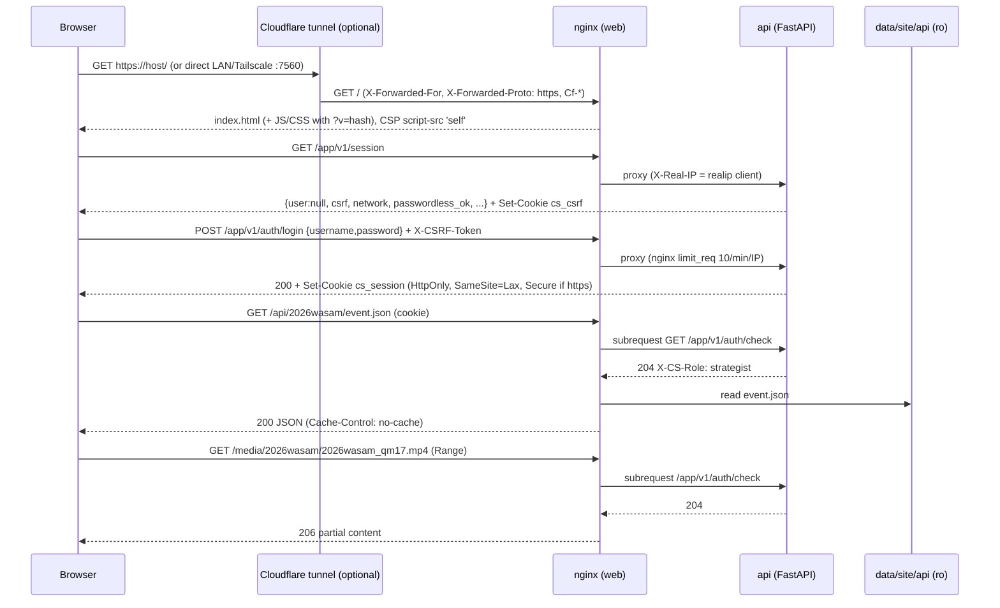

# Architecture

How Cyber-Scout is put together at runtime: the services, how they talk to each other, where every piece of state
lives, and the path a browser request takes. This describes the committed code (see the commit in
[README.md](README.md)) and the deployment on atomosserver, which was checked read-only while this was written.

> **In progress at time of writing.** Two other changes were being made while this was written. A
> performance pass touches `web/nginx.conf`, the `Dockerfile`s, the fetch code in `web/app.js` and
> `live/sitev2.py`. A competitions pass touches the `web/app.js` nav, the server routers and `live/worker.py`.
> Caching headers, the request path and the worker loop below describe the **committed** versions. Check
> `git log` for anything newer.
>
> **UX fix wave (2026-10-19, `56fda7c..c64b813`):** adds one file channel, worker → API `data/worker-status.json`
> (§3), and the Video page's link checks in the api (§7); §6 also corrects the no-model case (no wait).

---

## 1. The big picture

```
                         The Blue Alliance (REST v3, ETag-cached)        YouTube (yt-dlp, IPv4)
                                   |                                        |        |
                                   v                                        v        v
+------------------------- docker compose project "cyber-scout" -----------------------------------------+
|                                                                                                         |
|  worker  (image cyber-scout-worker)      recorder (same image, `--recorder`)                            |
|   live/worker.py main loop                live/liveingest.py Service                                    |
|   - polls TBA every POLL s                - one live/livestream.py child per followed event             |
|   - downloads match video                 - records the event livestream into MEDIA/live/...            |
|   - process.py -> enrich.py               - cuts match clips + match records (teams/scores via OCR)     |
|   - build_site(): site JSON               - writes data/events/<ev>/livestream.json (status)            |
|   - strategy/scouting subprocesses                                                                      |
|   - Video-page job thread (sources.job_loop)                                                            |
|        |  writes                                  |  writes                                             |
|        v                                          v                                                     |
|   ./data  (bind mount /data) <---------------- shared filesystem ---------------> ${MEDIA_DIR} (/media)  |
|        ^   app.db, config/worker.json,                                              kept videos, insets, |
|        |   events/<ev>/*, site/api/*                                                live/ recordings     |
|        |  reads/writes                                                                     ^             |
|   api  (image cyber-scout-api)  FastAPI + SQLite, uvicorn :8000 (not published)            |             |
|        ^   HTTP /app/v1/* and auth_request /app/v1/auth/check                              |             |
|        |                                                                                   | ro          |
|   web  (image cyber-scout-web)  nginx :80  ----- ro mounts: data/site/api -> /api/, MEDIA_DIR -> /media/ |
+--------|------------------------------------------------------------------------------------------------+
         | published ${WEB_BIND:-0.0.0.0}:${WEB_PORT:-7560}
         v
   browser on LAN / Tailscale (direct), or through a Cloudflare tunnel (cloudflared on the host)

   host (outside docker): cs-updater (systemd .path/.timer/.service), optional, NOT installed on atomosserver
   It talks to the api only through data/config/update-request.json and update-status.json.
```

The design rule is that **containers talk through files in `./data`, not through HTTP**, with one exception: nginx
proxies to the API. The worker never calls the API and the API never calls the worker. Settings flow API to worker
through `data/config/worker.json`. Video-setup jobs flow API to worker through `data/jobs/sources/*.json`.
Identity fixes go through `data/events/<ev>/overrides.json`, recorder status through
`data/events/<ev>/livestream.json`, the worker's own state (paused / waiting / last pass) through
`data/worker-status.json`, and the site itself through `data/site/api/**`, which nginx serves straight off disk.

---

## 2. Services

| service | image (built from) | entry | runs as | job |
|---|---|---|---|---|
| `worker` | `${CS_PREFIX}-worker:latest` (`Dockerfile`, repo root) | `sh /app/live/entrypoint.sh` → `python -u /app/live/worker.py` | root only long enough to `chown -R -h -P $PUID:$PGID /data`, then `setpriv --reuid=$PUID --regid=$PGID --clear-groups --no-new-privs` | TBA poll loop, match processing, site build; also runs the Video-page job thread |
| `recorder` | same image as worker | same entrypoint with `command: ["--recorder"]` → `liveingest.Service(DATA).run()` | same as worker | livestream recording + match cutting, one `live/livestream.py` subprocess per event |
| `api` | `${CS_PREFIX}-api:latest` (`server/Dockerfile`) | `sh /srv/server/entrypoint.sh` → `uvicorn server.main:app --host 0.0.0.0 --port 8000 --no-access-log` (one process) | root phase: `mkdir data/config`, `chown -h` of `app.db*`, `setup-code.txt`, `config/worker.json` (refuses to start if `$DATA` or `$DATA/config` is a symlink), then setpriv to PUID/PGID | accounts, sessions, settings, shared scouting data, video-setup endpoints, update requests, nginx `auth_request` target |
| `web` | `${CS_PREFIX}-web:latest` (`web/Dockerfile`, `nginx:1.29-alpine`) | stock nginx | nginx master as root (bind :80), workers as `nginx` | static SPA, reverse proxy to the API, gated static serving of site JSON and media |
| updater (host) | none: `deploy/updater/cs-updater.py` under systemd | `<prefix>-updater.service` (oneshot), started by `.path` (request file changed) and `.timer` (every 60 s) | the stack folder's owner (a `docker` group member, not root; refuses root unless `CS_UPDATER_ALLOW_ROOT=1`) | check / apply / rollback of the whole stack. **Not installed on atomosserver** (no units, no `updater/` folder) |

### Images

* **Worker image** (`Dockerfile`): `python:3.12-slim` plus the `deno` binary copied from `denoland/deno:bin-2.5.6`
  (yt-dlp needs a JS runtime for YouTube's player challenges), `ffmpeg` (apt), and one big pip layer:
  `onnxruntime-gpu[cuda,cudnn]==1.31.0`, `opencv-python-headless`, `av`, `numpy`, `scipy`, `networkx`,
  `pupil-apriltags`, `yt-dlp[default]`. That RUN line is kept **byte-identical** on purpose so the ~3 GB layer stays
  cached on the nearly full server disk. A second layer then installs the hash-pinned yt-dlp from
  `live/requirements-ytdlp.txt` (`--require-hashes --no-deps`, currently `yt-dlp[default,pin]==2026.8.19`) over it.
  Code layers follow: `COPY src/ live/ events/` into `/app`, `ENV DATA=/data`. The image is ~3.8 GB on the server.
  CUDA/cuDNN come from the pip wheels (`ort.preload_dlls()` in `live/detector.py`), not from a CUDA base image.
* **API image** (`server/Dockerfile`): `python:3.12-slim`, `server/requirements.txt` (fastapi 0.143, starlette 1.7,
  pydantic 2.14, uvicorn 0.54, argon2-cffi 25.1), `COPY server/` plus **`live/sources.py` and `live/layout.py`**,
  because the Video-page endpoints import them (stdlib-only at import). `server/tests` is deleted from the image.
  `HEALTHCHECK` hits `http://127.0.0.1:8000/app/v1/health` every 30 s. About 146 MB.
* **Web image** (`web/Dockerfile`): copies `web/nginx.conf` to `conf.d/default.conf`, and `web/*.html`, `web/*.js`,
  `web/*.css`, `web/field.jpg` and `web/fonts/` into `/usr/share/nginx/html/`. Then it **cache-busts**: `v` = the
  first 10 hex characters of `md5(cat *.js *.css)`, and `sed` appends `?v=<v>` to every local `src=`/`href=`
  `.js`/`.css` URL in `index.html`. The build fails if no URL got the suffix (`grep -c`). `lab/` is **not** shipped.
  About 64 MB.
* Build context for all three is the repo (`./app` on the server). `.dockerignore` excludes `.venv .git .env
  .roboflow_key out runs docs tools data/rf data/*.mp4`. `.work/` and `lab/` are not excluded, but no Dockerfile
  copies them, and on the server `app/` holds only tracked files anyway.

### Compose wiring (`deploy/docker-compose.yml`)

* Project name `${CS_PREFIX:-cyber-scout}`; container names `<prefix>-worker|recorder|api|web`. One default bridge
  network (`cyber-scout_default`, 172.25.0.0/16 on atomosserver). No custom networks, no internal network, and no
  egress limits.
* **Ports:** only `web` is published: `${WEB_BIND:-0.0.0.0}:${WEB_PORT:-7560}:80`. The API's 8000 is reachable only
  inside the compose network (nginx resolves `api` through Docker DNS `127.0.0.11`, per request, so nginx starts
  even when the api is down and answers 503 `@api_down`).
* **Volumes (bind mounts):**

  | container | host | container path | mode |
  |---|---|---|---|
  | worker, recorder | `./data` | `/data` | rw |
  | worker, recorder | `${MEDIA_DIR:-./data/media}` | `/media` | rw |
  | api | `./data` | `/data` | rw |
  | web | `./data/site/api` | `/usr/share/nginx/html/api` | **ro** |
  | web | `${MEDIA_DIR:-./data/media}` | `/usr/share/nginx/html/media` | **ro** |

  No named volumes. The api has no access to `MEDIA_DIR`. The web container cannot see anything in `data/` outside
  `site/api`.
* **Environment:** worker and recorder get the whole `.env` (`env_file: .env`) plus `DATA=/data`. The **api does
  not use `env_file`**: it gets `DATA`, `PUID`, `PGID`, `TZ`, `COOKIE_SECURE`, `PYTHONDONTWRITEBYTECODE` and an
  explicit allowlist of account settings from `.env` (`SESSION_IDLE_DAYS`, `SESSION_MAX_DAYS`, `PASSWORD_MIN`, `MEMBER_PASSWORD_MIN`, `SETUP_CODE_REQUIRED`, each with the
  `server/config.py` default). Secrets such as a legacy `TBA_KEY` never reach it.
* **Hardening** (from the security audit, commit 74e84af):

  | | worker | recorder | api | web |
  |---|---|---|---|---|
  | `security_opt` | `no-new-privileges:true` | same | same | same |
  | `cap_drop` | ALL | ALL | ALL | ALL |
  | `cap_add` | CHOWN, DAC_READ_SEARCH, SETUID, SETGID | same | CHOWN, DAC_OVERRIDE, SETUID, SETGID | CHOWN, NET_BIND_SERVICE, SETUID, SETGID |
  | `read_only` rootfs | no | no | yes (`/tmp` tmpfs 64 MB) | yes (tmpfs `/var/cache/nginx` 64 MB, `/var/run` 1 MB, `/tmp` 16 MB) |
  | `pids_limit` | 4096 | 4096 | 256 | 256 |
  | `mem_limit` | `${WORKER_MEM_LIMIT:-12g}` | `${RECORDER_MEM_LIMIT:-8g}` | `${API_MEM_LIMIT:-1g}` | `${WEB_MEM_LIMIT:-256m}` |
  | `restart` | unless-stopped | unless-stopped (`stop_grace_period: 30s`) | unless-stopped | unless-stopped |

  After `setpriv`, the Python processes run with no effective capabilities (CapEff 0, NoNewPrivs 1). The capabilities
  are needed only by the root phase of the entrypoints.
* **GPUs:** worker and recorder each reserve `driver: nvidia, device_ids: ["${GPU_IDS:-0}"], capabilities: [gpu]`.
  `GPU_IDS` uses host numbering (`nvidia-smi -L`). Inside the container the visible cards are renumbered from 0, so
  `GPU_DEVICE` (or the Admin `gpu_device` option) stays `0` for a single card. On atomosserver `GPU_IDS` is unset,
  so **both worker and recorder use host GPU 0** (RTX 3060 Ti, 8 GB). GPU 1 (RTX 3060, 12 GB) is left for
  development jobs (`/mnt/nas/autoscout-scratch`, see `live/HANDOFF.md`).
* **CPU-only:** `docker-compose.cpu.yml` resets `deploy` for worker and recorder (`deploy: !reset {}`, needs Compose
  ≥ 2.24) and sets `FORCE_CPU=1`. Enable it with `COMPOSE_FILE=docker-compose.yml:docker-compose.cpu.yml` in `.env`.
  `install.sh` writes that line when it finds no usable GPU.

### Users and ids

* `PUID`/`PGID` (default 1000/1000) is the host account that owns `./data`. On atomosserver that is `Grindlewalt`
  (1000:1000), the owner account, which is also in the `docker` and `wheel` groups. The audit recommends a dedicated
  uid (see [security.md](security.md)).
* The worker entrypoint `chown -R -h -P`s **all** of `/data` to PUID:PGID at every start (`-h -P`: never follow
  symlinks). The api entrypoint chowns only its own files. Everything the API writes lands as PUID, so the worker
  can read it, and the other way round.
* `HOME=/tmp` in both. `server/manage.py` (break-glass CLI) drops itself to PUID/PGID when run as root via
  `docker compose exec api ...`. The worker has no such guard, so a `docker compose exec worker ...` runs as **root**
  unless you pass `-u 1000:1000` (see [deploy.md](deploy.md)). It writes root-owned files until the next worker
  restart chowns them back.

---

## 3. How the components talk

### API → worker: settings (`data/config/worker.json`)

`server/workerconf.py:write()` rewrites it atomically, mode 0600, on API startup and after every settings or
events change:

```json
{"version": 1, "updated": 1791867130.9, "tba_key": "<secret>", "events": ["2026wasam"],
 "team_number": 4911, "season_goal": "DCMP",
 "options": {"poll_seconds": null, "gpu_device": null, "cpu_only": null, "hubcam": null}}
```

`live/worker.py:load_config()` re-reads it **every poll**. Anything null falls back to the environment (`TBA_KEY`,
`EVENTS`, `POLL_SECONDS`, `HUBCAM`, `GPU_DEVICE`, `FORCE_CPU`). It also exports `TBA_KEY`, `GPU_DEVICE` and
`FORCE_CPU` into `os.environ` for downstream modules (detector, OCR, strategy). `_sleep()` checks the file's mtime
every 5 s and wakes the loop early when it changes, so following a new event takes effect within seconds.
`liveingest.worker_config()` reads the same file for the recorder.

`team_number` and `season_goal` are written but **not read by any `live/` code**. The dashboard perspective is
`DASH_TEAM` (env, default `frc4911`) and the goal is `DASH_GOAL` (env, default `DCMP`).

### API → worker: video-setup jobs (`data/jobs/sources/<id>.json`)

The Video page (frame grabs, layout suggestions, AprilTag detection, calibration fits, overlays) creates jobs with
`live/sources.py:submit()`. A job runs **inline in the API process** if numpy/cv2 can be imported there. They
can't in the API image, so in practice the job is queued as a JSON file. The worker's daemon thread
(`sources.job_loop`, started in `worker.main()` before the TBA loop, so it runs **even with
`PAUSE_PROCESSING=1`**) claims each job with a `.lock` file, runs it and writes the result back into the same JSON.
The browser polls it through the API (`GET /app/v1/events/<ev>/jobs/<id>`). Jobs nobody picks up expire after an hour.

### API → worker: identity fixes (`data/events/<ev>/overrides.json`)

`PUT /app/v1/events/<ev>/overrides/<match>` (or an approved request) replaces that match's entry. The worker's next
`build_site()` passes the file to `identity.assign_event()`.

### Worker → API: live logs (`data/logs/<role>.json`)

`live/runlog.py` tees each worker-side process's stdout/stderr (so `log()`, other modules' prints, tracebacks and the
captured output of the site-build subprocesses) into a ring of the last 400 lines (each at most 400 characters, with a
`seq` and unix time) plus the current activity, and writes `{role, pid, started, at, doing, doing_since, also, seq, lines}`
atomically at most once a second (at once when the activity changes; `at` is refreshed every 15 s even when idle).
`role` = `worker`, `recorder` or `processor-<WORKER_ID>`. Secrets are redacted before a line enters the ring (the TBA key,
`key=`/`token=`/`sig=`/`auth=`/`password=` values, `Bearer` tokens, Discord webhook URLs, opaque tokens of 32+ characters;
match keys, video ids and paths stay). The API reads the files (`GET /admin/logs`, untrusted: no symlinks, size cap, typed
The same heartbeat also carries `gpus` (nvidia-smi: card, utilisation, memory; at most every 15 s, only where nvidia-smi exists) and the process's `GPU_IDS` / `GPU_DEVICE`; Admin → Jobs (`GET /admin/jobs`, `server/routers/jobs.py`) combines these with claims, processor heartbeats, `status.json`, Video-page job files and the site rows' `wait` reasons into one running / queued / recent snapshot.
fields) for Admin → Worker.

### Worker → API: processing state (`data/worker-status.json`)

`live/worker.py:status_beat(reason)` writes `{at, paused, reason}` (`reason` = `paused` | `no_key` | `no_events` |
null) at the top of every main-loop pass: every 30 s while it waits, once per pass while it works. Process-only
processors and the recorder don't write it. `server/workerstatus.py` reads it for `GET /app/v1/session` →
`processing: {paused, worker_seen, reason, why, worker_down}` (signed-in users only; missing file = unknown; older
than 1 h = `paused: null`). `worker_down` = no write for 5 min, or no file 10 min after the api started ("never
started"); for admins it carries the host updater's view of the worker container (state, Docker's error, why/fix),
because a container that can't start (a GPU passthrough error) never writes anything. The web app shows "Processing
is paused on the server" / "The worker isn't running" from it ([web.md](web.md) §4.7). The Admin switch (worker option `paused` in `worker.json`) wins over
`PAUSE_PROCESSING` in `.env`; the worker reports which one paused it (`paused_by`).

### Recorder → worker: livestream records (`MEDIA/live/<ev>/<video id>/matches/*.json`)

The recorder's `livestream.py` child writes one record per match plus a clip. The worker's `liveingest.LiveView`
reads them on every `sync()` and `build_site()`. `worker._sleep()` also watches `liveingest.records_signature()`
and wakes the loop when a new record appears. The recorder writes its status to `data/events/<ev>/livestream.json`,
which the API serves at `GET /app/v1/events/<ev>/livestream`.

### API ↔ host updater (`data/config/update-request.json`, `update-status.json`)

The API writes a fixed-schema request (`{"v":1,"action":"check|apply|rollback","nonce":<32 hex>,"at",...}`) and
reads the status file. The updater validates the request again, refuses symlinks and is the only thing that runs
git or docker. With no updater heartbeat in 180 s, the API reports `installed: false` and returns 409 on actions,
which is the state on atomosserver.

### Worker → browser: the site (`data/site/api/**`)

The worker (and the strategy and scouting subprocesses it starts) writes plain JSON files. nginx serves them
read-only at `/api/...` after an auth check. **No application server is on the data path.** Every byte of scouting
data a browser sees is a static file.

### Who writes and reads what

| file (under `data/` unless noted) | written by | read by |
|---|---|---|
| `app.db` (+ `-wal`, `-shm`) | api | api only |
| `setup-code.txt` (0600, only while no users exist) | api (`auth.ensure_setup_code`) | api; a human (`install.sh` prints it) |
| `config/worker.json` (0600) | api (`workerconf.write`) | worker (`load_config`), recorder (`liveingest.worker_config`) |
| `config/update-request.json` | api (`routers/update.py`) | host updater |
| `config/update-status.json` | host updater | api |
| `worker-status.json` | worker (`status_beat`, every loop pass) | api (`workerstatus.processing_state` → `/session.processing`) |
| `jobs/sources/<id>.json`, `<id>.lock` | api (create), worker job thread (claim, result) | api (`GET /events/<ev>/jobs/<id>`), worker |
| `models/robot.onnx` | `install.sh` (`CS_MODEL_URL`) or by hand | worker (`MODEL`), training scripts |
| `models/robot.pt`, `training/` | training scripts (`live/train/`, `live/make_labels.py`) | training only; nothing at runtime |
| `tba/<endpoint>.json` (e.g. `event__2026wasam__matches.json`) | `live/tba.py` (ETag cache) | worker, strategy, scouting, reprocess |
| `cache/ytmeta.json` | worker (YouTube metadata memo) | worker |
| `cache/ytmeta_oembed.json` | `live/sources.py` discovery | sources |
| `cache/<match>_<vid>.mp4` (+ `.part*`) | worker download (deleted after each match; failed yt-dlp runs can leave `.part` files) | worker |
| `cache/srcvid/` | `live/layout.py` (frame grabs from URLs) | layout jobs |
| `cache/strategy/backtest_<ev>.json` | `live/strategy/dashboard.py` (prequential backtest rows) | dashboard |
| `cache/tba_prior/`, `cache/tba_district/`, `cache/statbotics/` | `strategy/epa.py`, `district.py`, `goals.py` | strategy |
| `cache/tba_live/` | recorder (event dates and timezone) | recorder |
| `events/<ev>/sources.json` | api (Video page), `sources.discover` | worker (`sources.video_config`), recorder (`pick_source`), api |
| `events/<ev>/layout.json` | api (layout editor) | pipeline via `layout.find()` (process, fuel, stationcam, livestream, OCR) |
| `events/<ev>/camera.json` (+ `.bak-<ts>`) | api (`POST /calibration/overhead/accept`) or by hand | worker, enrich, reprocess, build_site |
| `events/<ev>/station_red.json`, `station_blue.json` | api (calibration accept for `station_*`) or by hand | stationcam, station_ocr, hubcam |
| `events/<ev>/camera_<source id>.json` | **by hand only** (no code writes it) | liveingest (is the stream trackable?) |
| `events/<ev>/calib_wizard/<target>.json`, `frames/*.jpg`, `frames/calib_*` | api / job thread | api (wizard state, sample frames) |
| `events/<ev>/event.json` | by hand (optional) | worker (`videos.candidates` prefs: `prefer`, `reject`, `allow_channels`, `search_title`) |
| `events/<ev>/overrides.json` | api (identity fixes) or by hand | worker `build_site` → `identity.assign_event` |
| `events/<ev>/status.json` | worker | worker, `build_site` (row state) |
| `events/<ev>/pose_latest.json`, `pose_latest_<source>.json` | worker (last verified camera pose; moved to `.bak-<ts>` by a calibration accept) | worker (`pose_guess` for the next match) |
| `events/<ev>/matches/<key>.json` | worker `process_match` / `reprocess.py` (`<key>.live-teams.json` when a stream-tracked match is re-tracked) | `build_site`, enrich, strategy |
| `events/<ev>/fuel/<key>.json` | `enrich.enrich` (airborne fuel tracks for the player) | `build_site` (copied to `site/api/<ev>/m/<key>.fuel.json`) |
| `events/<ev>/shots/<key>.json` | `enrich.enrich`, `station_pass` | `build_site`, scouting |
| `events/<ev>/analytics/<key>.json` | `enrich.enrich`, `station_pass` | `build_site` |
| `events/<ev>/stations/<key>.json` | `station_export.export` (HUBCAM=1) | `build_site` (Analyze camera switcher) |
| `events/<ev>/livestream.json` | recorder | api (`GET /events/<ev>/livestream`), worker (`live_summary`) |
| `site/api/events.json` | worker `build_site` | browser; api (`routers/events.py` event names) |
| `site/api/<ev>/event.json`, `m/<key>.json`, `m/<key>.fuel.json`, `t/<team>.json` | worker `build_site`; `sitev2.verified_team_files` rewrites `t/*` and parts of `event.json` | browser, strategy, scouting |
| `site/api/<ev>/dashboard.json`, `dashboard.<team>.json`, `preview/<key>.json`, `dash/<ts>.json`, `dash/index.json` | `python -m live.strategy.dashboard ... --site --snapshots --only-missing` (worker subprocess) | browser, scouting, goals |
| `site/api/<ev>/spec/<team>.json`, `spec/index.json`, `defense.json`, `scout.json` | `scouting.site_build_extra` (worker, in-process) | browser, goals (pitch cards), dashboard (defense) |
| `site/api/<ev>/scout/<ts>.json`, `scout/index.json` | `python -m live.scouting DATA EV --snapshots` (worker subprocess) | browser (replay), goals |
| `site/api/<ev>/rankings.json`, `schedule.json`, `selection.json` | `goals.site_build` (worker, in-process) | browser |
| `site/api/<ev>/selection/<ts>.json`, `selection/index.json` | `python -m live.strategy.goals DATA EV --selection-snapshots` (worker subprocess) | browser |
| `MEDIA/<ev>/<key>.mp4` | worker (moves the chosen download here when `KEEP_VIDEO=1`) | nginx `/media/`, reprocess, `station_pass` |
| `MEDIA/<ev>/insets/<key>.mp4` | worker `station_reads` / `station_pass` (HUBCAM=1) | stationcam, nginx |
| `MEDIA/live/<ev>/<video id>/...` | recorder (`livestream.py`) | worker (`LiveView`), nginx (`/media/live/.../clips/*`) |

---

## 4. Where state lives

### `data/` (the bind-mounted state directory; back this up)

```
data/                                   owned by PUID:PGID (worker re-chowns everything at start)
├── app.db, app.db-wal, app.db-shm      SQLite (WAL), 0600. Tables: users, sessions, settings, events, picklists,
│                                       picklist_versions, notes, override_log, override_requests, audit_log
│                                       (DDL in server/db.py; details in server.md). Holds the TBA key + argon2 hashes.
├── setup-code.txt                      one-time first-run code (exists only while there are no users)
├── worker-status.json                  {at, paused, reason}: the worker's last loop pass (api → /session.processing)
├── config/
│   ├── worker.json                     0600: the worker's copy of the settings (incl. TBA key)
│   ├── update-request.json             api -> host updater (transient)
│   └── update-status.json              host updater -> api (progress, heartbeat)
├── jobs/sources/<id>.json|.lock        Video-page job queue
├── models/robot.onnx                   YOLO robot detector (required for processing); robot.pt = training checkpoint
├── training/                           detector training data (rf/ = cached Roboflow export, dom/, r1.pt, r2.pt); ~1 GB, not used at runtime
├── tba/                                TBA response cache (event, matches, oprs, rankings, teams)
├── cache/                              disposable: downloads in flight, ytmeta.json, srcvid/, strategy/, tba_prior/,
│                                       tba_district/, tba_live/, statbotics/
├── events/<ev>/
│   ├── camera.json[.bak-<ts>]          overhead calibration (falls back to the image's /app/events/<ev>/camera.json)
│   ├── camera_<source>.json            calibration of a livestream camera (hand-made)
│   ├── station_red.json, station_blue.json   driver-station inset calibrations (fallback: repo events/<ev>/)
│   ├── sources.json, layout.json       Video page: sources and layout boxes
│   ├── event.json                      optional video preferences (fallback: repo events/<ev>/event.json)
│   ├── calib_wizard/<target>.json, frames/   calibration wizard state and sample frames
│   ├── overrides.json                  manual robot -> team fixes
│   ├── status.json                     per-match state {state: processing|done|no_video|error|failed, at, video,
│   │                                   attempts, error, source, live_*}
│   ├── pose_latest[_<source>].json     last verified camera pose, carried to the next match
│   ├── livestream.json                 recorder status
│   ├── matches/<key>.json              processed tracks (the expensive output, ~200 s of GPU per match)
│   ├── fuel/<key>.json                 airborne ball tracks (image px) for the player
│   ├── shots/<key>.json                shots, intakes, reconcile, hub_active, timing
│   ├── analytics/<key>.json            per-robot behaviour metrics (team-agnostic)
│   └── stations/<key>.json             station-camera sync/poses (HUBCAM=1 only)
└── site/api/                           everything the browser reads (served read-only by nginx at /api/)
    ├── events.json                     followed events with progress
    └── <ev>/
        ├── event.json                  match rows + team rows (+ livestream summary)
        ├── m/<key>.json, m/<key>.fuel.json   per-match page data / fuel tracks
        ├── t/<team>.json               per-team data (verified matches only, after sitev2.verified_team_files)
        ├── spec/<team>.json, spec/index.json   team spec sheets
        ├── defense.json                defense library
        ├── scout.json, scout/<ts>.json, scout/index.json   canonical per-team truth (+ replay snapshots)
        ├── dashboard.json, dashboard.<team>.json, preview/<key>.json, dash/<ts>.json, dash/index.json
        ├── rankings.json, schedule.json
        └── selection.json, selection/<ts>.json, selection/index.json
```

On atomosserver (`/opt/stacks/cyber-scout/data`, about 1.5 GB): `training/` ~1 GB, `cache/` ~241 MB (including
about 185 MB of stale `*.part` downloads from 2026-10-10), `site/` ~121 MB, `events/` ~108 MB, `models/` ~37 MB,
`app.db` 100 KB. `data/events/2026wasam/` contains only `matches/` (74), `fuel/`, `shots/`, `analytics/`,
`stations/`, `status.json` and `pose_latest.json`. There is **no** `camera.json`, `sources.json` or `layout.json`
there, so production uses the calibration baked into the image (`/app/events/2026wasam/camera.json`) and the
hard-coded 2026 FIRST layout defaults.

### `MEDIA_DIR` (host path; `/media` in worker/recorder, `/usr/share/nginx/html/media` in web)

```
${MEDIA_DIR}/                           atomosserver: /mnt/nas/autoscout-media (7.3 TB NAS disk), ~12 GB
├── <ev>/<key>.mp4                      kept match videos (~80-100 MB each; 75 entries for 2026wasam incl. insets/)
├── <ev>/insets/<key>.mp4               "Match N" uploads with the driver-station insets (HUBCAM=1)
└── live/<ev>/<video id>/               livestream recordings (LIVE_DIR, default MEDIA/live)
    ├── seg/*.ts                        60 s MPEG-TS segments (trimmed by budget / age)
    ├── chunks.jsonl                    index of every 5 s chunk (sq, file, offset, size, pts, wall time)
    ├── clips/                          per-match clips (kept)
    ├── matches/<id>.json               match records (teams, scores, start, clip, flags)
    ├── evidence/                       OCR evidence crops
    ├── recorder.json, analyzer.json    progress
    ├── meta.json                       event, source, url, video id (written by liveingest)
    └── livestream.log, service.out     logs
```

`MEDIA_DIR/live` is empty on atomosserver (no livestream has been recorded there yet). Without `MEDIA_DIR` in
`.env`, media goes to `./data/media`.

### In the images (read-only, from the repo)

`/app/events/<ev>/` (camera, station calibrations, `calib_input.json`, `event.json`), `/app/live/field/`
(AprilTag CSV, `rebuilt_rules.json`), `/app/live/models/ocr/*.onnx` (PP-OCRv3, ~13 MB). `ev_file()` in the worker
checks `data/events/<ev>/<name>` first and falls back to the repo copy.

---

## 5. The request path

```
browser
  │  http://<lan-or-tailscale-ip>:7560/...            (direct: client IP = its own 10.x / 100.x address)
  │  https://<public host>  → Cloudflare edge → cloudflared on the host → http://127.0.0.1:7560 or the docker gateway
  ▼
nginx (web container, :80)
  ├─ realip: trust X-Forwarded-For only from 172.16.0.0/12 (docker gateways) and 127.0.0.1, real_ip_recursive on
  ├─ $fwd_proto = X-Forwarded-Proto only when the peer is the proxy; HSTS only when that is https
  ├─ location ~ /\.  and  ~* \.(db|db-wal|db-shm|db-journal|sqlite|sqlite3|bak|swp|env|pem|key)$   → 404
  ├─ = /app/v1/auth/login        limit_req 10 r/min per IP (burst 10) → proxy to api
  ├─ ^~ /app/v1/                 proxy to http://api:8000 (timeout 120 s, body ≤ 25 MB); X-Frame-Options DENY,
  │                              CSP default-src 'none'; 502/504 → 503 JSON "the Cyber-Scout API is not running"
  ├─ /api/                       auth_request /_auth → static file from data/site/api (Cache-Control: no-cache)
  ├─ /media/                     auth_request /_auth → static file from MEDIA_DIR (Cache-Control: private, max-age=86400)
  └─ /                           the SPA shell (public; holds no data): try_files $uri /index.html, no-cache, full CSP
```

`/_auth` is an `internal` location that proxies to `GET /app/v1/auth/check` without the body. It forwards
`X-Real-IP`, the client's `X-Forwarded-For` and `X-Forwarded-Proto`. Original request headers, cookies and `Cf-*`
included, go along by default. The API answers **204 + `X-CS-Role`** for any valid session (viewer or higher) and
401 otherwise. A 401 becomes the JSON `{"detail":"sign in required"}` (`@unauthorized`). A 5xx becomes the 503
`@api_down`. Media is plain static serving by nginx (byte ranges work for `<video>` seeking). There is no
`X-Accel-Redirect` and the API never streams files. Every `/api/` and `/media/` request costs one auth
subrequest, which is one SQLite session lookup. nginx does not cache these.



**Security headers.** The shell gets the full CSP: `default-src 'self'; script-src 'self'; style-src 'self'
'unsafe-inline' https://fonts.googleapis.com; font-src 'self' data: https://fonts.gstatic.com; img-src 'self' data:
blob: https://i.ytimg.com https://img.youtube.com; media-src 'self' blob:; connect-src 'self'; frame-src
https://www.youtube.com https://www.youtube-nocookie.com; worker-src 'self' blob:; object-src 'none'; base-uri
'self'; form-action 'self'; frame-ancestors 'self'`. It also gets `X-Frame-Options: SAMEORIGIN`, `nosniff`,
`Referrer-Policy: same-origin`, and a `Permissions-Policy` that turns off camera, microphone and the like. Data
locations get `default-src 'none'; media-src 'self'`. API responses also get `Cache-Control: no-store` and the
same headers from the FastAPI middleware.

**Network classification.** For passwordless sign-in and the audit log's lan/public flag, the API trusts
`X-Real-IP`. nginx sets it from `$remote_addr`, which realip rewrites only for trusted peers.
`deps.via_public()` also treats any request that carries a proxy marker (`Cf-Connecting-Ip`, `Cf-Ray`,
`Cdn-Loop`, `Cf-Visitor`, `True-Client-Ip`, `Forwarded`) or a public hop in `X-Forwarded-For` as **public**. It
fails closed even if the realip list is wrong.

**Cloudflare on atomosserver.** The host runs several `cloudflared-*.service` tunnels, none of them named for
Cyber-Scout, and a dashboard-managed `cloudflare/cloudflared:latest` container (`fervent_matsumoto`). Its ingress
rules live in the Cloudflare dashboard and could not be checked from the host. The nginx comment refers to
`https://scout...` through the tunnel. Whether the site is publicly reachable is an owner check (see
[security.md](security.md)). Tailscale (`tailscaled`) is running on the host.

---

## 6. Processing flow inside the worker (control view)

```
main()
 ├─ --recorder → liveingest.Service(DATA).run()             (recorder container only)
 ├─ thread: sources.job_loop(DATA)                          (Video-page jobs; always on)
 └─ loop:
     load_config()                                          worker.json → env fallbacks
     status_beat(reason)                                    data/worker-status.json (paused | no_key | no_events | null)
     waiting if PAUSE_PROCESSING=1 | no TBA key | no events  (re-check every 30 s)
     no model file → TBA + livestream results only, robot tracking off until it appears
     for ev in events: sync(ev, tba)
        ├─ matches = TBA matches (+ livestream-only matches from LiveView)
        ├─ cfg = sources.video_config(sources.json, events/<ev>/event.json, layout.json)
        ├─ for each played match without matches/<key>.json (state != failed):
        │     process_match()  → download (≤3 candidates) → process.process() → matches/<key>.json
        │                       → enrich.enrich() (fuel → shots → intakes → analytics)
        │                       → move video to MEDIA/<ev>/<key>.mp4 → [HUBCAM: station_pass]
        │     build_site(ev)   after EVERY processed match
        └─ if nothing was processed: build_site(ev) anyway   (so the site is rebuilt every poll)
     _sleep(POLL)  (wakes early on worker.json change or new livestream record)

build_site(ev)
 ├─ identity.assign_event(results, matches, overrides)  → per-track team labels
 ├─ writes m/<key>.json, m/<key>.fuel.json, t/<team>.json, event.json, ../events.json
 ├─ subprocess: python -m live.strategy.dashboard DATA ev --site --snapshots --only-missing   (timeout 900 s)
 ├─ scouting.site_build_extra(DATA, ev)   (verified team files, spec sheets, defense.json, scout.json)
 ├─ subprocess: python -m live.scouting DATA ev --snapshots
 ├─ goals.site_build(DATA, ev, team=DASH_TEAM)   (rankings.json, schedule.json, selection.json)
 └─ subprocess: python -m live.strategy.goals DATA ev --selection-snapshots
```

Retry policy: a match with no acceptable video is retried after `RETRY_NO_VIDEO` = 300 s. Errors increment
`attempts`, and after `MAX_ATTEMPTS` = 3 the state becomes `failed` and the match is skipped until you edit
`status.json`. A video whose bumper reads say it is another match (`integrity.should_retry`) makes the worker try
the next upload. See [pipeline.md](pipeline.md) for the stages.

---

## 7. Environment variables

`.env` lives next to `docker-compose.yml` and is mode 0600. Compose uses it twice: for `${VAR}` interpolation in
the compose file, and as `env_file` for **worker and recorder only**.

### Compose / infrastructure (interpolated by Compose)

| var | default | meaning |
|---|---|---|
| `CS_PREFIX` | `cyber-scout` | project, container and image name prefix (run a second copy side by side) |
| `WEB_PORT` | `7560` | published web port |
| `WEB_BIND` | `0.0.0.0` | address to publish on (set a LAN or Tailscale IP to restrict) |
| `MEDIA_DIR` | `./data/media` | host path for kept videos and recordings (mounted at `/media`). Not read by Python. |
| `GPU_IDS` | `0` | host GPU index(es) reserved for worker + recorder |
| `PUID` / `PGID` | `1000` | owner of `./data`; the processes run as this id |
| `TZ` | `UTC` (api) | time zone |
| `COOKIE_SECURE` | `auto` | passed to the api: `auto` (Secure iff X-Forwarded-Proto https), `1`, `0` |
| `WORKER_MEM_LIMIT`, `RECORDER_MEM_LIMIT`, `API_MEM_LIMIT`, `WEB_MEM_LIMIT` | 12g, 8g, 1g, 256m | memory caps |
| `COMPOSE_FILE` | unset | `docker-compose.yml:docker-compose.cpu.yml` for CPU-only |

### Worker and recorder (`live/`)

| var | read in | default | meaning |
|---|---|---|---|
| `DATA` | worker, layout, liveingest, livestream | `/data` | state dir (set by compose) |
| `MEDIA` | worker, liveingest, sources | `/media` | media dir inside the container (not `MEDIA_DIR`) |
| `MODEL` | worker | `$DATA/models/robot.onnx` | detector |
| `TBA_KEY` | worker, epa, livestream | — | fallback when `worker.json` has none (`X_TBA_AUTH_KEY` also accepted by `strategy/epa.py`) |
| `EVENTS` | worker, liveingest | — | comma list; fallback when events were never managed in the app |
| `POLL_SECONDS` | worker | `120` | TBA poll interval (Admin option `poll_seconds` wins) |
| `PAUSE_PROCESSING` | worker | unset | `1`: the loop only waits. **No matches and no site rebuilds.** Video-page jobs still run. The recorder is unaffected. Admin → Settings → Processing overrides it without a restart. |
| `ONCE`, `MAX_NEW` | worker | unset | one sync pass and exit; cap new matches per pass |
| `GPU_DEVICE` | detector, ocr, liveingest | `0` | CUDA device id inside the container (Admin `gpu_device` wins) |
| `FORCE_CPU` | detector, ocr | unset | `1` = CPU only (cpu override, Admin `cpu_only`) |
| `OCR_GPU` | ocr, livestream | `GPU_DEVICE` (`livestream.py --gpu` default `1`; liveingest always passes `--gpu`) | OCR device |
| `HUBCAM` | worker | `0` | station-camera pass (inset download, station OCR, hub-cam verification) |
| `V2` | worker | `1` | fuel, shots, analytics enrichment |
| `KEEP_VIDEO` | worker | `1` | move the processed video to `MEDIA/<ev>/` |
| `VIDEO_CACHE` | worker | `$DATA/cache` | download scratch |
| `ID_CONF_MIN` | worker, enrich, scouting | `0.5` | identity quarantine threshold |
| `DASHBOARD` | worker | `1` | run the strategy dashboard build |
| `DASH_TEAM` | worker, dashboard, goals | `frc4911` | perspective team |
| `DASH_GOAL` | goals | `DCMP` | season goal |
| `DASH_AWARD_CONTENDER` | goals | `0` | count our award chances in the headline goal odds |
| `DCMP_CAPACITY` | goals | `district.CAPACITY` | DCMP size override |
| `RECON_GATE` | coverage | `0.2` | TBA reconciliation gate |
| `YTDLP` | videos, sources, layout, livestream, liveingest | `yt-dlp` | binary |
| `YT_FORCE_IPV4` | videos, liveingest | `1` | pass `-4` to yt-dlp (last download attempt goes without) |
| `CS_URL_ALLOW` | sources | — | private hosts/CIDRs allowed as source URLs (SSRF guard exceptions). A pasted link is checked in the **api**, which compose doesn't give this variable (see API below) |
| `CS_SOURCE_ROOTS` | sources | — | extra `:`-separated roots for absolute-path sources (besides `/media`, `/data`) |
| `LAYOUT` | layout | — | force a layout file; `none` disables layouts |
| `LIVESTREAM` | liveingest | `1` | `0` disables the recorder |
| `LIVE_DIR` | liveingest | `$MEDIA/live` | recordings root |
| `LIVE_POLL` | liveingest | `10` | service loop seconds |
| `LIVE_RESOLVE_S` | liveingest | `120` | re-check interval for a stream that is not live |
| `LIVE_BUDGET_GB` | liveingest → livestream | `60` | per-stream disk budget |
| `LIVE_MIN_FREE_GB` | liveingest | `30` | free-space floor on the LIVE_DIR disk |
| `LIVE_KEEP_HOURS`, `LIVE_KEEP_MATCH_HOURS` | liveingest → livestream | `2`, `12` | segment retention (non-match / match) |
| `LIVE_KEEP_SEG_DAYS` | liveingest | `2` | delete segments of finished streams after this |
| `LIVE_MAX_HOURS` | liveingest → livestream | `16` | max recording length per child |
| `LIVE_BACKFILL_MIN` | liveingest → livestream | `60` | on a fresh dir, also record this many minutes already streamed |
| `LIVE_ANY_DATE` | liveingest | unset | `1` skips the event-date check |
| `LS_LEAD`, `LS_TAIL`, `LS_SAMPLE_HZ`, `LS_OCR_HZ`, `LS_FULL_EVERY`, `LS_FORMAT` | livestream | 8, 5, 10, 2, 4, `312/301/bv*[height<=1080]...` | clip padding, analyser rates, HLS format |
| `OCR_*` (`OCR_WORKERS` 4, `OCR_PROC` 1, `OCR_PERIOD` 0.3, `OCR_PERIOD_READ`, `OCR_FRESH` 3.0, `OCR_MAX_PER_FRAME` 3, `OCR_CONF` 0.30, `OCR_T1` 190, `OCR_MAX_DET` 512, `OCR_ANGLES` `0,45,-45`, `OCR_OPENSET` 1, `OCR_OPEN_REJECT` 0, `OCR_OPEN_MARGIN` 1.0, `OCR_CUDA` auto) | ocr | as listed | bumper OCR tuning; `OCR_CUDA` auto = CUDA only in a process whose detector is on CUDA (`OCR_PROC=0` thread, station OCR), 1 force, 0 never; CUDA failure -> CPU |
| `CYBERSCOUT_OCR_DIR`, `CYBERSCOUT_OCR_THREADS`, `CYBERSCOUT_OCR_CUDA` | ocr, identity | — | OCR model dir / threads / device (identity's older OCR path) |
| `CONF_KEEP`, `CONF_TRACK`, `START_FALLBACK`, `SCAN_T1`, `CLOCK_BOX` | process | 0.10, 0.30, 6.5, 190, `912,72,1008,116` | detection thresholds, match-start fallback, clock crop |
| `HC_BOUNCE_CROWD`, `HC_BOUNCE_D0` | hubcam | 1, 25.0 | hub-cam bounce-out tests |
| `BEF1`, `AFT1`, `PPAD`, `PH`, `MIN_LOSS`, `ROLLING`, `OUTPOST` | intakes | 1.4, 1.4, 0.30, 0.9, module default, off, off | intake detector tuning (experimental) |
| `STEP`, `DET_CONF` | make_labels | 2.0, 0.35 | auto-labelling (training only) |
| `RF` | train/dl.py | — | Roboflow key (training only) |

### API (`server/config.py`)

These are read by the API, but compose passes only `DATA`, `PUID`, `PGID`, `TZ` and `COOKIE_SECURE`. Putting the
rest in `.env` has **no effect** unless you add them to the api's `environment:` block.

| var | default | meaning |
|---|---|---|
| `DATA` | `/data` | state dir |
| `SETUP_CODE_REQUIRED` | `1` | first-run setup needs `data/setup-code.txt` |
| `SESSION_IDLE_DAYS` / `SESSION_MAX_DAYS` | 7 / 30 | session lifetime |
| `COOKIE_SECURE` | `auto` | see above |
| `PASSWORD_MIN` / `MEMBER_PASSWORD_MIN` | 10 / 4 | password lengths (admins / others) |
| `TBA_BASE` | `https://www.thebluealliance.com/api/v3` | TBA endpoint (tests) |
| `TBA_KEY`, `EVENTS` | — | legacy one-time import into an empty DB (`main.seed_from_env`) |
| `PUID`, `PGID` | 1000 | entrypoint and `server.manage` privilege drop |
| `CS_URL_ALLOW` | — | read by `live/sources.py` when a link is pasted on the Video page; **not passed** by compose, so private hosts are always refused there |
| `CS_PROBE_LINKS` | `1` | `0` skips the one `HEAD` request that checks a pasted direct video link (`sources.probe_http`); not passed by compose (a test / dev switch) |

### Host updater (`updater/updater.conf`, not an env file)

`REMOTE` (default `https://github.com/Grindlewalt/Cyber-Scout.git`), `BRANCH` (`main`), `SSH_KEY`, `MIN_FREE_GB`
(1.0), `HEAVY_BUILD_GB` (3.5), `LIGHT_BUILD_GB` (0.3), `HEALTH_TIMEOUT` (300), `BUILD_TIMEOUT` (5400),
`AUTO_CHECK_HOURS` (24), `DB_BACKUPS_KEEP` (5), `YTDLP` (1). Each value is checked against a regex or parsed as
numeric. The env var `CS_UPDATER_ALLOW_ROOT=1` allows running it as root.

### Inconsistencies worth knowing

* **The legacy `.env` import is off on purpose.** `server/README.md` says the API imports `TBA_KEY` / `EVENTS`
  from `.env` on first start; the api service has no `env_file` and its allowlist leaves them out, so the key is
  entered in the setup wizard instead (`deploy/README.md` says so). The account settings (`SETUP_CODE_REQUIRED`,
  `SESSION_*`, `PASSWORD_MIN`, `MEMBER_PASSWORD_MIN`) do reach it since the cleanup pass.
* **`team_number` / `season_goal` from Admin are not used by the worker.** The dashboard team and goal come from
  `DASH_TEAM` / `DASH_GOAL` (defaults frc4911 / DCMP).
* **`camera_<source id>.json`** (needed for tracking from a livestream) is not produced by the calibration wizard.
  The wizard writes `camera.json` with a `source` key, and liveingest accepts that only when the wizard was run on
  the stream source.
* The `docker compose exec worker` default user is **root** (no `-u`), unlike `server.manage`, which drops
  privileges itself.
